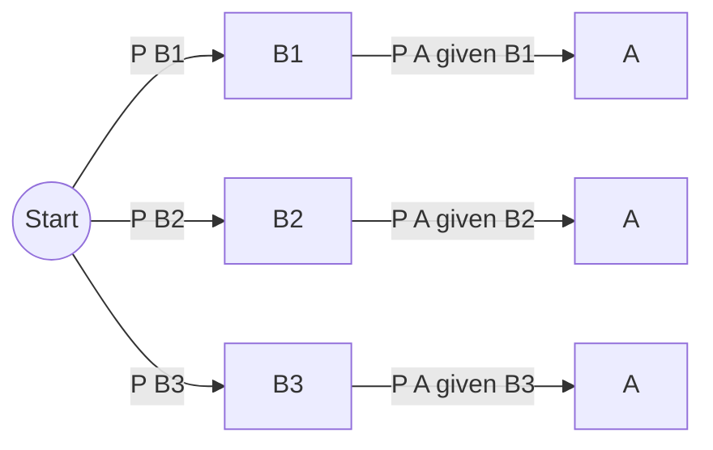
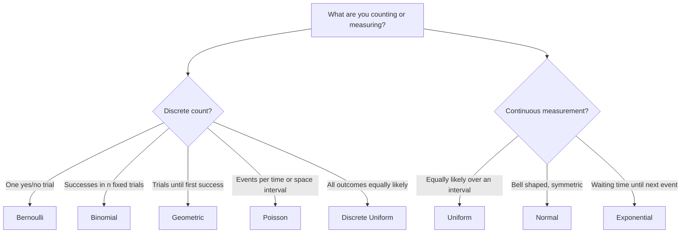

- [[#1. Introduction to Probability]]
- [[#2. Conditional Probability]]
- [[#3. Bayes' Theorem]]
- [[#4. Random Variables]]
- [[#5. Probability Distributions]]
- [[#6. Master Summary Table]]
- [[#7. Practice Problems]]

> [!note] Notation used 
> $P(A)$ = probability of event $A$, 
> $A^c$ = complement
> $A\cup B$ = "A or B"
> $A\cap B$ = "A and B"
> $E[X]$ = expected value
> $\text{Var}(X)$ = variance
> $\sigma$ = standard deviation. 
> $P(A\mid B)$ conditional probability

# 1. Introduction to Probability

## 1.1 Basic Terminology

|Term|Meaning|Example (roll a die)|
|---|---|---|
|**Experiment**|A process with uncertain outcome|Rolling a die|
|**Outcome**|One possible result|$4$|
|**Sample space** $S$ (or $\Omega$)|Set of **all** outcomes|$S={1,2,3,4,5,6}$|
|**Event**|A subset of $S$|"even number" $={2,4,6}$|
|**Simple event**|Event with exactly one outcome|${3}$|
|**Mutually exclusive (disjoint)**|Cannot happen together: $A\cap B=\varnothing$|"even" and "odd"|
|**Exhaustive**|Together cover the whole $S$|"even" and "odd"|

## 1.2 Definition of Probability

### Classical (equally likely outcomes)

$$ P(A)=\frac{\text{number of outcomes favourable to } A}{\text{total number of outcomes in } S}=\frac{n(A)}{n(S)} $$

> [!warning] Only valid when all outcomes are equally likely A fair coin and fair die satisfy this. "It either rains or it doesn't, so $P=1/2$" does **not**.

### Frequentist (long-run)

$$ P(A)=\lim_{n\to\infty}\frac{\text{times } A \text{ occurred}}{n} $$

### Axiomatic (Kolmogorov) - the foundation

For any events in a sample space $S$:

1. **Non-negativity:** $P(A)\ge 0$
2. **Normalisation:** $P(S)=1$
3. **Additivity:** if $A_1, A_2,\dots$ are mutually exclusive then $$ P\left(\bigcup_i A_i\right)=\sum_i P(A_i) $$

## 1.3 Fundamental Rules

**Complement rule**

$$ P(A^c)=1-P(A) $$

**Addition rule (general)**

$$ P(A\cup B)=P(A)+P(B)-P(A\cap B) $$

If $A,B$ are mutually exclusive, $P(A\cap B)=0$ so

$$ P(A\cup B)=P(A)+P(B) $$

**Three events**

$$ P(A\cup B\cup C)=P(A)+P(B)+P(C)-P(A\cap B)-P(B\cap C)-P(A\cap C)+P(A\cap B\cap C) $$

**Other useful facts**

$$ 0\le P(A)\le 1,\qquad P(\varnothing)=0,\qquad A\subseteq B\Rightarrow P(A)\le P(B) $$

> [!tip] Why subtract the overlap? Adding $P(A)+P(B)$ counts the overlap $A\cap B$ twice. Subtract it once to fix.

## 1.4 Independent Events

$A$ and $B$ are **independent** if knowing one happened tells you nothing about the other:

$$ P(A\cap B)=P(A),P(B) $$

> [!warning] Independent ≠ Mutually exclusive If $A,B$ are mutually exclusive and both have non-zero probability, they are **dependent** (if $A$ happens, $B$ definitely didn't).

## 1.5 Counting Tools (needed for classical probability)

**Multiplication principle:** if task 1 can be done in $m$ ways and task 2 in $n$ ways, both can be done in $m\times n$ ways.

**Factorial:** $n! = n(n-1)(n-2)\cdots 1$, with $0!=1$.

**Permutations** (order matters), choose $r$ of $n$:

$$ {}^nP_r=\frac{n!}{(n-r)!} $$

**Combinations** (order doesn't matter):

$$ \binom{n}{r}={}^nC_r=\frac{n!}{r!,(n-r)!} $$

Useful identities: $\binom{n}{r}=\binom{n}{n-r}$, $\binom{n}{0}=\binom{n}{n}=1$.

## 1.6 Solved Examples

**Example 1.1 - Two dice.** Find the probability that the sum is 7.

$S$ has $6\times6=36$ equally likely outcomes. Favourable: $(1,6),(2,5),(3,4),(4,3),(5,2),(6,1)$ → 6 outcomes.

$$ P(\text{sum}=7)=\frac{6}{36}=\frac16 $$

**Example 1.2 - "At least one" trick.** A fair coin is tossed 3 times. Find $P(\text{at least one head})$.

It's easier to use the complement. "No heads" means TTT, and $|S|=2^3=8$.

$$ P(\text{at least one head})=1-P(\text{TTT})=1-\frac18=\frac78 $$

**Example 1.3 - Addition rule.** A card is drawn from a standard 52-card deck. Find $P(\text{King or Heart})$.

$$ P(K)=\frac{4}{52},\quad P(H)=\frac{13}{52},\quad P(K\cap H)=\frac1{52} $$

$$ P(K\cup H)=\frac{4}{52}+\frac{13}{52}-\frac{1}{52}=\frac{16}{52}=\frac{4}{13} $$

**Example 1.4 - Combinations.** A committee of 3 is chosen at random from 5 men and 4 women. Find $P(\text{exactly 2 women})$.

$$ n(S)=\binom{9}{3}=84,\qquad n(A)=\binom{4}{2}\binom{5}{1}=6\times5=30 $$

$$ P(A)=\frac{30}{84}=\frac{5}{14}\approx0.357 $$

==🟡**Example 1.5 - Birthday problem.** Probability that in a group of $n$ people at least two share a birthday (365 days, ignore leap years):==

$$ P(\text{shared})=1-\frac{365}{365}\cdot\frac{364}{365}\cdots\frac{365-n+1}{365} $$

For $n=23$ this is $\approx 0.507$. So 23 people already give a better-than-even chance.

---

# 2. Conditional Probability

## 2.1 Intuition

Conditional probability is the probability of $A$ **after you learn that $B$ has happened**. Learning $B$ shrinks the sample space from $S$ down to $B$.

## 2.2 Definition

$$ P(A\mid B)=\frac{P(A\cap B)}{P(B)},\qquad P(B)>0 $$

Read: "probability of $A$ **given** $B$".

## 2.3 Multiplication Rule

Rearranging the definition:

$$ P(A\cap B)=P(B),P(A\mid B)=P(A),P(B\mid A) $$

For three events (chain rule):

$$ P(A\cap B\cap C)=P(A),P(B\mid A),P(C\mid A\cap B) $$

## 2.4 Independence via Conditional Probability

$A,B$ independent $\iff$ $P(A\mid B)=P(A)$ $\iff$ $P(B\mid A)=P(B)$.

## 2.5 Law of Total Probability

Let $B_1,B_2,\dots,B_n$ be a **partition** of $S$ (mutually exclusive and exhaustive, each with $P(B_i)>0$). For any event $A$:

$$ P(A)=\sum_{i=1}^{n}P(A\mid B_i),P(B_i) $$

> [!tip] Mental picture A **tree diagram**: first split by which $B_i$ happened, then within each branch ask how likely $A$ is. Multiply along branches, add across branches.

## 2.6 Solved Examples

**Example 2.1 - Dice.** Two dice are rolled. Let $A$ = "sum is 8", $B$ = "first die is even". Find $P(A\mid B)$.

$P(B)=\frac{18}{36}$. $A\cap B={(2,6),(4,4),(6,2)}$, so $P(A\cap B)=\frac{3}{36}$.

$$ P(A\mid B)=\frac{3/36}{18/36}=\frac{3}{18}=\frac16 $$

**Example 2.2 - Cards without replacement.** Two cards are drawn from a deck without replacement. Find $P(\text{both are aces})$.

$$ P(A_1\cap A_2)=P(A_1),P(A_2\mid A_1)=\frac{4}{52}\cdot\frac{3}{51}=\frac{12}{2652}=\frac{1}{221} $$

**Example 2.3 - Total probability.** A factory has three machines:

|Machine|Share of production|Defect rate|
|---|---|---|
|A|50%|2%|
|B|30%|3%|
|C|20%|5%|

Find the probability that a randomly chosen item is defective.

$$ \begin{aligned} P(D)&=P(D\mid A)P(A)+P(D\mid B)P(B)+P(D\mid C)P(C)\ &=(0.02)(0.5)+(0.03)(0.3)+(0.05)(0.2)\ &=0.010+0.009+0.010=0.029 \end{aligned} $$

So 2.9% of all items are defective. (This result is reused in Example 3.1.)

---

# 3. Bayes' Theorem

## 3.1 Intuition

Conditional probability gives $P(A\mid B)$. Often you know it the **wrong way round**: you know $P(\text{evidence}\mid\text{cause})$ but want $P(\text{cause}\mid\text{evidence})$. Bayes' theorem flips the conditioning.

## 3.2 Formula

**Simple form**

$$ P(A\mid B)=\frac{P(B\mid A),P(A)}{P(B)} $$

**Full form** (with a partition $A_1,\dots,A_n$ and the total probability law in the denominator)

$$ P(A_i\mid B)=\frac{P(B\mid A_i),P(A_i)}{\displaystyle\sum_{j=1}^{n}P(B\mid A_j),P(A_j)} $$

|Piece|Name|
|---|---|
|$P(A_i)$|**Prior** - belief before seeing evidence|
|$P(B\mid A_i)$|**Likelihood** - how likely the evidence is under cause $A_i$|
|$P(B)$|**Evidence / marginal** - normalising constant|
|$P(A_i\mid B)$|**Posterior** - updated belief after evidence|

$$ \text{Posterior}=\frac{\text{Likelihood}\times\text{Prior}}{\text{Evidence}} $$

## 3.3 Step-by-step method

1. Name the causes $A_i$ (partition) and the evidence $B$.
2. Write down priors $P(A_i)$ and likelihoods $P(B\mid A_i)$.
3. Compute $P(B)$ by total probability.
4. Compute each posterior. They must **sum to 1**.

## 3.4 Solved Examples

**Example 3.1 - Factory (continuing 2.3).** An item is found defective. What's the probability it came from machine A, B, C?

$$ P(A\mid D)=\frac{0.010}{0.029}=\frac{10}{29}\approx0.345 $$

$$ P(B\mid D)=\frac{0.009}{0.029}=\frac{9}{29}\approx0.310 $$

$$ P(C\mid D)=\frac{0.010}{0.029}=\frac{10}{29}\approx0.345 $$

Check: $10/29+9/29+10/29=1$ ✓. Notice machine C makes only 20% of items but accounts for ~34.5% of defects.

**Example 3.2 - Medical test (the classic).** A disease affects 1% of a population. A test has **sensitivity** 99% ($P(+\mid D)=0.99$) and **specificity** 95% ($P(-\mid D^c)=0.95$, so false-positive rate is 5%). A person tests positive. Find $P(D\mid +)$.

$$ \begin{aligned} P(+)&=P(+\mid D)P(D)+P(+\mid D^c)P(D^c)\ &=(0.99)(0.01)+(0.05)(0.99)\ &=0.0099+0.0495=0.0594 \end{aligned} $$

$$ P(D\mid +)=\frac{0.0099}{0.0594}=\frac16\approx0.167 $$

> [!important] Surprising but true Even with a "99% accurate" test, a positive result means only about a 17% chance of disease, because the disease is rare and false positives from the large healthy group swamp the true positives.
> 
> **Natural-frequency check** (10,000 people): 100 are sick → 99 test positive. 9,900 are healthy → 495 test positive. So of $99+495=594$ positives, only $99$ are truly sick: $99/594=1/6$ ✓.

**Example 3.3 - Two bags.** Bag 1 has 3 red, 2 blue. Bag 2 has 1 red, 4 blue. A bag is chosen at random (prob. $\tfrac12$ each) and a ball is drawn; it is red. Find the probability it came from Bag 1.

$$ P(R)=\frac35\cdot\frac12+\frac15\cdot\frac12=\frac{4}{10}=\frac25 $$

$$ P(\text{Bag 1}\mid R)=\frac{(3/5)(1/2)}{2/5}=\frac{3/10}{4/10}=\frac34 $$

> [!bug] Common mistakes
> 
> - Confusing $P(A\mid B)$ with $P(B\mid A)$ (the "prosecutor's fallacy").
> - Ignoring the prior (base rate).
> - Forgetting that the denominator must sum over **all** causes.

---

# 4. Random Variables

## 4.1 What is a Random Variable?

A **random variable (RV)** is a function that assigns a **number** to each outcome of an experiment:

$$ X:S\to\mathbb{R} $$

> [!example] Example Toss 2 coins. $S={HH,HT,TH,TT}$. Let $X$ = number of heads. Then $X(HH)=2$, $X(HT)=X(TH)=1$, $X(TT)=0$.

Capital letter $X$ = the random variable; small letter $x$ = a particular value it can take. $P(X=x)$ means "probability the RV equals $x$".

## 4.2 Types

||**Discrete**|**Continuous**|
|---|---|---|
|Values|Countable (0,1,2,...)|Any value in an interval|
|Examples|Heads in 10 tosses, defects in a batch|Height, waiting time, temperature|
|Described by|PMF|PDF|
|$P(X=x)$|can be $>0$|always $0$|
|Probabilities from|**summing** PMF|**integrating** PDF|

## 4.3 Discrete: Probability Mass Function (PMF)

$$ p(x)=P(X=x) $$

Conditions:

$$ p(x)\ge0,\qquad \sum_x p(x)=1 $$

## 4.4 Continuous: Probability Density Function (PDF)

$f(x)$ is a density. **Area** under it gives probability:

$$ P(a\le X\le b)=\int_a^b f(x),dx $$

Conditions:

$$ f(x)\ge0,\qquad \int_{-\infty}^{\infty}f(x),dx=1 $$

> [!warning] Density ≠ probability $f(x)$ itself can exceed 1 (e.g., Uniform on $[0,0.5]$ has $f=2$). Only areas are probabilities. Also for continuous RVs, $P(a\le X\le b)=P(a<X<b)$.

## 4.5 Cumulative Distribution Function (CDF)

Works for both types:

$$ F(x)=P(X\le x) $$

|Discrete|Continuous|
|---|---|
|$F(x)=\displaystyle\sum_{t\le x}p(t)$|$F(x)=\displaystyle\int_{-\infty}^{x}f(t),dt$|

Properties: non-decreasing, $F(-\infty)=0$, $F(\infty)=1$, $P(a<X\le b)=F(b)-F(a)$. For continuous RVs, $f(x)=F'(x)$.

## 4.6 Expectation (Mean)

The long-run average value of $X$.

$$ E[X]=\mu=\sum_x x,p(x)\quad\text{(discrete)},\qquad E[X]=\int_{-\infty}^{\infty}x,f(x),dx\quad\text{(continuous)} $$

**Expectation of a function** (LOTUS - Law of the Unconscious Statistician):

$$ E[g(X)]=\sum_x g(x),p(x)\qquad\text{or}\qquad\int g(x)f(x),dx $$

**Properties**

$$ E[aX+b]=aE[X]+b,\qquad E[X+Y]=E[X]+E[Y]\ \text{(always)} $$

$$ E[XY]=E[X]E[Y]\ \text{only if } X,Y \text{ independent} $$

## 4.7 Variance and Standard Deviation

Measures spread around the mean.

$$ \text{Var}(X)=\sigma^2=E\big[(X-\mu)^2\big] $$

**Computational shortcut (use this one!)**

$$ \boxed{\text{Var}(X)=E[X^2]-\big(E[X]\big)^2} $$

$$ \sigma=\sqrt{\text{Var}(X)} $$

**Properties**

$$ \text{Var}(aX+b)=a^2,\text{Var}(X) $$

$$ \text{Var}(X+Y)=\text{Var}(X)+\text{Var}(Y)\ \text{if } X,Y\text{ independent} $$

> [!tip] Adding a constant $b$ shifts the mean but does **not** change the spread. Multiplying by $a$ scales the spread by $|a|$ (variance by $a^2$).

## 4.8 Solved Examples

**Example 4.1 - Discrete.** $X$ = number of heads in 2 fair coin tosses.

|$x$|0|1|2|
|---|---|---|---|
|$p(x)$|1/4|1/2|1/4|

$$ E[X]=0\cdot\tfrac14+1\cdot\tfrac12+2\cdot\tfrac14=1 $$

$$ E[X^2]=0\cdot\tfrac14+1\cdot\tfrac12+4\cdot\tfrac14=\tfrac32 $$

$$ \text{Var}(X)=\tfrac32-1^2=\tfrac12 $$

**Example 4.2 - Continuous.** $f(x)=2x$ for $0\le x\le1$, else $0$.

Check validity: $\displaystyle\int_0^1 2x,dx=\big[x^2\big]_0^1=1$ ✓

$$ E[X]=\int_0^1 x(2x),dx=\int_0^1 2x^2dx=\frac23 $$

$$ E[X^2]=\int_0^1 2x^3dx=\frac12,\qquad \text{Var}(X)=\frac12-\frac49=\frac1{18} $$

CDF: $F(x)=x^2$ on $[0,1]$. Hence $P(X>0.5)=1-F(0.5)=1-0.25=0.75$.

**Example 4.3 - Finding the constant.** $f(x)=c,x^2$ on $0\le x\le 3$. Find $c$ and $P(1<X<2)$.

$$ \int_0^3 cx^2dx=c\cdot\frac{27}{3}=9c=1\ \Rightarrow\ c=\frac19 $$

$$ P(1<X<2)=\int_1^2\frac{x^2}{9}dx=\frac{1}{9}\cdot\frac{8-1}{3}=\frac{7}{27} $$

**Example 4.4 - Linear transformation.** If $E[X]=4$, $\text{Var}(X)=9$, find $E[3X-2]$ and $\text{Var}(3X-2)$.

$$ E[3X-2]=3(4)-2=10,\qquad \text{Var}(3X-2)=3^2\cdot 9=81 $$

---

# 5. Probability Distributions

> [!abstract] Roadmap **Discrete:** Bernoulli, Discrete Uniform, Binomial, Poisson, Geometric **Continuous:** Continuous Uniform, Normal, Exponential

---

## 5.1 Bernoulli Distribution

**When:** a single trial with exactly two outcomes, success (1) or failure (0).

**Notation:** $X\sim\text{Bernoulli}(p)$, where $p=P(\text{success})$.

**PMF**

$$ P(X=x)=p^x(1-p)^{1-x},\qquad x\in{0,1} $$

i.e. $P(X=1)=p$, $P(X=0)=1-p=q$.

**Mean and variance**

$$ E[X]=p,\qquad \text{Var}(X)=p(1-p)=pq $$

_Derivation:_ $E[X]=0\cdot q+1\cdot p=p$. Since $X^2=X$, $E[X^2]=p$, so $\text{Var}=p-p^2=p(1-p)$.

**Example 5.1.** A biased coin lands heads with $p=0.3$. Then $E[X]=0.3$, $\text{Var}(X)=0.3\times0.7=0.21$.

> [!tip] Why it matters Bernoulli is the **building block**: Binomial = sum of Bernoullis; Geometric = number of Bernoulli trials until the first 1.

---

## 5.2 Uniform Distribution

### (a) Discrete Uniform

**When:** $n$ equally likely values (fair die, random card number).

$X\sim U{a,a+1,\dots,b}$ with $n=b-a+1$ values:

$$ P(X=x)=\frac1n $$

$$ E[X]=\frac{a+b}{2},\qquad \text{Var}(X)=\frac{n^2-1}{12} $$

**Example 5.2.** Fair die: $a=1,b=6,n=6$.

$$ E[X]=3.5,\qquad \text{Var}(X)=\frac{36-1}{12}=\frac{35}{12}\approx2.917 $$

### (b) Continuous Uniform

**When:** any value in $[a,b]$ is equally likely (e.g., random arrival time within an interval).

$X\sim U(a,b)$:

$$ f(x)=\begin{cases}\dfrac{1}{b-a}, & a\le x\le b\[2mm] 0,&\text{otherwise}\end{cases} \qquad F(x)=\begin{cases}0,&x<a\[1mm]\dfrac{x-a}{b-a},&a\le x\le b\[2mm]1,&x>b\end{cases} $$

$$ E[X]=\frac{a+b}{2},\qquad \text{Var}(X)=\frac{(b-a)^2}{12} $$

Probability of a sub-interval is just its **length fraction**:

$$ P(c\le X\le d)=\frac{d-c}{b-a} $$

**Example 5.3.** $X\sim U(2,8)$. Then $f(x)=\tfrac16$, $E[X]=5$, $\text{Var}(X)=\tfrac{36}{12}=3$.

$$ P(X>5.5)=\frac{8-5.5}{6}=\frac{2.5}{6}=\frac5{12}\approx0.417 $$

---

## 5.3 Binomial Distribution

**When:** count the number of successes in $n$ **fixed, independent** trials, each with the same success probability $p$.

> [!note] BINS check **B**inary outcomes, **I**ndependent trials, **N** fixed, **S**ame $p$ each trial.

**Notation:** $X\sim\text{Bin}(n,p)$.

**PMF**

$$ P(X=k)=\binom{n}{k}p^k(1-p)^{n-k},\qquad k=0,1,\dots,n $$

_Why:_ any specific sequence with $k$ successes has probability $p^k q^{n-k}$, and there are $\binom nk$ such sequences.

**Mean and variance**

$$ E[X]=np,\qquad \text{Var}(X)=np(1-p)=npq $$

_Derivation sketch:_ $X=X_1+\cdots+X_n$ with $X_i\sim\text{Bernoulli}(p)$ independent, so $E[X]=np$ and $\text{Var}(X)=n\cdot p(1-p)$.

**Shape:** symmetric if $p=0.5$; skewed right if $p<0.5$; skewed left if $p>0.5$. Most likely value ≈ $\lfloor (n+1)p\rfloor$.

**Example 5.4 - Coins.** 10 fair coin tosses. $P(\text{exactly 6 heads})$:

$$ P(X=6)=\binom{10}{6}\left(\tfrac12\right)^{10}=\frac{210}{1024}\approx0.2051 $$

**Example 5.5 - Guessing on a quiz.** 10 MCQs with 4 options each, all guessed ($p=0.25$).

$$ P(X=3)=\binom{10}{3}(0.25)^3(0.75)^7=120\times0.015625\times0.13348\approx0.2503 $$

$$ P(X\ge1)=1-P(X=0)=1-(0.75)^{10}=1-0.0563=0.9437 $$

$$ E[X]=10(0.25)=2.5,\qquad \text{Var}(X)=10(0.25)(0.75)=1.875 $$

> [!bug] Common mistakes
> 
> - Using Binomial when trials are **not independent** (e.g., drawing without replacement from a small population - that's Hypergeometric).
> - Forgetting the $\binom nk$ factor.

---

## 5.4 Normal (Gaussian) Distribution

**When:** measurements influenced by many small independent effects: heights, marks, measurement errors. It also appears as the limit of sums (Central Limit Theorem).

**Notation:** $X\sim N(\mu,\sigma^2)$.

**PDF**

$$ f(x)=\frac{1}{\sigma\sqrt{2\pi}}\exp!\left(-\frac{(x-\mu)^2}{2\sigma^2}\right),\qquad -\infty<x<\infty $$

**Mean and variance**

$$ E[X]=\mu,\qquad \text{Var}(X)=\sigma^2 $$

**Shape facts**

- Bell-shaped and **symmetric** about $\mu$; mean = median = mode.
- $\mu$ shifts the curve; $\sigma$ stretches it (larger $\sigma$ → flatter, wider).
- Total area = 1; inflection points at $\mu\pm\sigma$.

### Empirical Rule (68-95-99.7)

$$ P(\mu-\sigma\le X\le\mu+\sigma)\approx0.6827 $$

$$ P(\mu-2\sigma\le X\le\mu+2\sigma)\approx0.9545 $$

$$ P(\mu-3\sigma\le X\le\mu+3\sigma)\approx0.9973 $$

### Standard Normal and Z-scores

Any normal can be converted to the **standard normal** $Z\sim N(0,1)$ by

$$ Z=\frac{X-\mu}{\sigma} $$

Then $P(X\le x)=\Phi!\left(\dfrac{x-\mu}{\sigma}\right)$, where $\Phi(z)=P(Z\le z)$ is the standard normal CDF (z-table).

**Handy z-table values**

|$z$|0|0.5|1|1.28|1.5|1.645|1.96|2|2.576|
|---|---|---|---|---|---|---|---|---|---|
|$\Phi(z)$|0.5000|0.6915|0.8413|0.8997|0.9332|0.9500|0.9750|0.9772|0.9950|

**Symmetry rules**

$$ \Phi(-z)=1-\Phi(z),\qquad P(Z>z)=1-\Phi(z),\qquad P(a<Z<b)=\Phi(b)-\Phi(a) $$

**Example 5.6.** Marks $X\sim N(70,10^2)$.

(a) $P(X>85)$: $z=\dfrac{85-70}{10}=1.5$

$$ P(X>85)=1-\Phi(1.5)=1-0.9332=0.0668 $$

(b) $P(60<X<80)$: $z$ from $-1$ to $1$

$$ P=\Phi(1)-\Phi(-1)=0.8413-0.1587=0.6827 $$

(c) Top 10% cut-off: need $z$ with $\Phi(z)=0.90$, so $z\approx1.2816$.

$$ x=\mu+z\sigma=70+1.2816(10)\approx82.8 $$

### Normal approximation to the Binomial

If $n$ is large (rule of thumb: $np\ge5$ and $nq\ge5$), then

$$ \text{Bin}(n,p)\approx N\big(np,\ npq\big) $$

Use **continuity correction**: $P(X\le k)\approx P(Y\le k+0.5)$.

**Example 5.7.** $X\sim\text{Bin}(100,0.5)$, find $P(X\le55)$. Here $\mu=50$, $\sigma=\sqrt{25}=5$.

$$ P(X\le55)\approx\Phi!\left(\frac{55.5-50}{5}\right)=\Phi(1.1)\approx0.8643 $$

**Linear combinations:** if $X\sim N(\mu,\sigma^2)$ then $aX+b\sim N(a\mu+b,\ a^2\sigma^2)$. For independent normals, $X+Y\sim N(\mu_X+\mu_Y,\ \sigma_X^2+\sigma_Y^2)$.

---

## 5.5 Poisson Distribution

**When:** count of **rare, independent events** in a fixed interval of time/space, occurring at a constant average rate. Examples: calls per hour, typos per page, accidents per day.

**Notation:** $X\sim\text{Poisson}(\lambda)$, where $\lambda>0$ is the average number of events per interval.

**PMF**

$$ P(X=k)=\frac{e^{-\lambda}\lambda^k}{k!},\qquad k=0,1,2,\dots $$

**Mean and variance (equal!)**

$$ E[X]=\lambda,\qquad \text{Var}(X)=\lambda $$

**Scaling the interval:** if the rate is $\lambda$ per unit time, then in $t$ units the mean is $\lambda t$.

**Poisson approximation to Binomial:** when $n$ is large and $p$ is small,

$$ \text{Bin}(n,p)\approx\text{Poisson}(\lambda=np) $$

**Example 5.8.** A call centre gets on average 3 calls per hour ($\lambda=3$).

$$ P(X=0)=e^{-3}\approx0.0498 $$

$$ P(X=2)=\frac{e^{-3}3^2}{2!}=4.5,e^{-3}\approx0.2240 $$

$$ P(X\ge1)=1-e^{-3}\approx0.9502 $$

$$ P(X\le2)=e^{-3}\left(1+3+\frac{9}{2}\right)=8.5,e^{-3}\approx0.4232 $$

**Example 5.9 - Change of interval.** Same centre, 30 minutes: $\lambda=3\times0.5=1.5$.

$$ P(X=1)=1.5,e^{-1.5}\approx0.3347 $$

**Example 5.10 - Approximation.** 200 items, each defective independently with $p=0.01$. $X\sim\text{Bin}(200,0.01)$, so $\lambda=np=2$.

$$ P(X=3)\approx\frac{e^{-2}2^3}{3!}=\frac{8}{6}\times0.1353\approx0.1804 $$

---

## 5.6 Geometric Distribution

**When:** number of independent Bernoulli($p$) trials needed to get the **first success** (waiting time in discrete steps).

**Notation:** $X\sim\text{Geom}(p)$, $X\in{1,2,3,\dots}$.

**PMF** (first $k-1$ trials fail, trial $k$ succeeds)

$$ P(X=k)=(1-p)^{k-1}p,\qquad k=1,2,\dots $$

**Tail and CDF**

$$ P(X>k)=(1-p)^k,\qquad F(k)=P(X\le k)=1-(1-p)^k $$

**Mean and variance**

$$ E[X]=\frac1p,\qquad \text{Var}(X)=\frac{1-p}{p^2} $$

> [!note] Two conventions Some books define $Y$ = number of **failures** before the first success, so $P(Y=k)=(1-p)^kp$ for $k=0,1,\dots$ with $E[Y]=\frac{1-p}{p}$. Check which one your course uses. These notes use the "number of trials" version.

**Memoryless property**

$$ P(X>m+n\mid X>m)=P(X>n) $$

Past failures don't make a success "due". The process restarts fresh each time.

**Example 5.11.** Roll a fair die until the first six. $p=\tfrac16$.

$$ E[X]=6,\qquad \text{Var}(X)=\frac{5/6}{1/36}=30 $$

$$ P(X=3)=\left(\tfrac56\right)^2\tfrac16=\frac{25}{216}\approx0.1157 $$

$$ P(X>4)=\left(\tfrac56\right)^4=\frac{625}{1296}\approx0.4823 $$

---

## 5.7 Exponential Distribution

**When:** **waiting time** until the next event in a Poisson process (time between calls, lifetime of a component, time between arrivals).

**Notation:** $X\sim\text{Exp}(\lambda)$, where $\lambda>0$ is the **rate** (events per unit time).

**PDF and CDF**

$$ f(x)=\lambda e^{-\lambda x},\quad x\ge0 \qquad F(x)=1-e^{-\lambda x} $$

**Survival function**

$$ P(X>x)=e^{-\lambda x} $$

**Mean and variance**

$$ E[X]=\frac1\lambda,\qquad \text{Var}(X)=\frac1{\lambda^2} $$

**Median:** $\dfrac{\ln2}{\lambda}$ (smaller than the mean, because the distribution is right-skewed).

**Memoryless property** (the only continuous distribution with it)

$$ P(X>s+t\mid X>s)=P(X>t) $$

> [!important] Link between Poisson and Exponential If events happen at rate $\lambda$ per unit time (Poisson count), then the **time between consecutive events** is $\text{Exp}(\lambda)$. Poisson counts events; Exponential measures the gap. Likewise, Geometric is the discrete analogue of Exponential.

**Example 5.12.** Average wait for a bus is 5 minutes, so $\lambda=\tfrac15=0.2$ per minute.

$$ P(X>10)=e^{-0.2\times10}=e^{-2}\approx0.1353 $$

$$ P(X<3)=1-e^{-0.6}\approx1-0.5488=0.4512 $$

Memoryless: given you've already waited 5 minutes, the chance of waiting at least 10 more is

$$ P(X>15\mid X>5)=P(X>10)=e^{-2}\approx0.1353 $$

Median wait: $\dfrac{\ln 2}{0.2}\approx3.47$ minutes.

---

# 6. Master Summary Table

|Distribution|Type|Parameters|PMF / PDF|Mean|Variance|
|---|---|---|---|---|---|
|Bernoulli|Discrete|$p$|$p^x(1-p)^{1-x}$|$p$|$p(1-p)$|
|Discrete Uniform|Discrete|$a,b$ ($n=b-a+1$)|$\dfrac1n$|$\dfrac{a+b}{2}$|$\dfrac{n^2-1}{12}$|
|Binomial|Discrete|$n,p$|$\dbinom nk p^k(1-p)^{n-k}$|$np$|$np(1-p)$|
|Poisson|Discrete|$\lambda$|$\dfrac{e^{-\lambda}\lambda^k}{k!}$|$\lambda$|$\lambda$|
|Geometric|Discrete|$p$|$(1-p)^{k-1}p$|$\dfrac1p$|$\dfrac{1-p}{p^2}$|
|Continuous Uniform|Continuous|$a,b$|$\dfrac1{b-a}$|$\dfrac{a+b}2$|$\dfrac{(b-a)^2}{12}$|
|Normal|Continuous|$\mu,\sigma^2$|$\dfrac{1}{\sigma\sqrt{2\pi}}e^{-\frac{(x-\mu)^2}{2\sigma^2}}$|$\mu$|$\sigma^2$|
|Exponential|Continuous|$\lambda$|$\lambda e^{-\lambda x}$|$\dfrac1\lambda$|$\dfrac1{\lambda^2}$|

## Key Relationships

- Bernoulli($p$) is Binomial($1,p$).
- Sum of $n$ independent Bernoulli($p$) is Binomial($n,p$).
- Binomial, $n$ large and $p$ small → Poisson($np$).
- Binomial, $n$ large, $np,nq\ge5$ → Normal($np,npq$).
- Poisson process: counts ~ Poisson, gaps ~ Exponential.
- Geometric (discrete) and Exponential (continuous) are both **memoryless**.

## Formula Cheat Sheet

$$ P(A\cup B)=P(A)+P(B)-P(A\cap B)\qquad P(A\mid B)=\frac{P(A\cap B)}{P(B)} $$

$$ P(A_i\mid B)=\frac{P(B\mid A_i)P(A_i)}{\sum_j P(B\mid A_j)P(A_j)}\qquad \text{Var}(X)=E[X^2]-(E[X])^2 $$

$$ Z=\frac{X-\mu}{\sigma}\qquad F_{\text{Exp}}(x)=1-e^{-\lambda x}\qquad P_{\text{Geom}}(X>k)=(1-p)^k $$

---

# 7. Practice Problems

> [!question] Try first, then expand the answer Answers are in the collapsible blocks below each problem.

**Q1.** A card is drawn from a deck. Find the probability that it is a face card (J, Q, K) or a spade.

> [!success]- Answer Face cards: 12. Spades: 13. Overlap (J♠, Q♠, K♠): 3. $$P=\frac{12+13-3}{52}=\frac{22}{52}=\frac{11}{26}$$

**Q2.** $P(A)=0.5$, $P(B)=0.4$, $P(A\cap B)=0.2$. Are $A$ and $B$ independent? Find $P(A\mid B)$.

> [!success]- Answer $P(A)P(B)=0.2=P(A\cap B)$, so **independent**. $P(A\mid B)=0.2/0.4=0.5=P(A)$.

**Q3.** An urn has 5 red and 3 green balls. Two balls are drawn without replacement. Find $P(\text{both red})$.

> [!success]- Answer $$\frac58\cdot\frac47=\frac{20}{56}=\frac{5}{14}$$

**Q4.** Email filter: 20% of emails are spam. The filter flags 95% of spam and also 2% of non-spam. An email is flagged. What's the probability it's spam?

> [!success]- Answer $$P(F)=0.95(0.2)+0.02(0.8)=0.19+0.016=0.206$$ $$P(S\mid F)=\frac{0.19}{0.206}\approx0.922$$

**Q5.** $X$ has PMF $p(1)=0.2,\ p(2)=0.5,\ p(3)=0.3$. Find $E[X]$ and $\text{Var}(X)$.

> [!success]- Answer $E[X]=0.2+1.0+0.9=2.1$. $E[X^2]=0.2+2.0+2.7=4.9$. $\text{Var}=4.9-4.41=0.49$.

**Q6.** $f(x)=kx$ on $[0,2]$. Find $k$, $E[X]$.

> [!success]- Answer $\int_0^2kx,dx=2k=1\Rightarrow k=\tfrac12$. $E[X]=\int_0^2\tfrac{x^2}{2}dx=\tfrac{8}{6}=\tfrac43$.

**Q7.** A fair coin is tossed 8 times. Find $P(X=5)$ and $E[X],\text{Var}(X)$ for the number of heads.

> [!success]- Answer $$P(X=5)=\binom85\frac1{256}=\frac{56}{256}=0.21875$$ $E[X]=4$, $\text{Var}(X)=8(0.5)(0.5)=2$.

**Q8.** Heights are $N(170,,8^2)$ cm. Find the probability a person is taller than 186 cm.

> [!success]- Answer $z=\frac{186-170}{8}=2$. $P=1-\Phi(2)=1-0.9772=0.0228$.

**Q9.** A website gets 4 hits per minute on average (Poisson). Find the probability of exactly 2 hits in a minute, and of at least 1 hit in 30 seconds.

> [!success]- Answer $P(X=2)=\frac{e^{-4}4^2}{2}=8e^{-4}\approx0.1465$. 30 s: $\lambda=2$, $P(X\ge1)=1-e^{-2}\approx0.8647$.

**Q10.** Each attempt at a free throw succeeds with $p=0.4$. Find the expected number of attempts until the first success and $P(\text{first success on 3rd attempt})$.

> [!success]- Answer $E[X]=1/0.4=2.5$. $P(X=3)=(0.6)^2(0.4)=0.144$.

**Q11.** Machine lifetime is exponential with mean 200 hours. Find the probability it lasts more than 300 hours, and the probability it lasts another 100 hours given it has already survived 300.

> [!success]- Answer $\lambda=1/200$. $P(X>300)=e^{-1.5}\approx0.2231$. Memoryless: $P(X>400\mid X>300)=P(X>100)=e^{-0.5}\approx0.6065$.

**Q12.** Arrival time of a train is uniform between 10:00 and 10:30. Find the probability it arrives after 10:20 and the expected arrival time.

> [!success]- Answer $P=\frac{10}{30}=\frac13$. Mean $=10{:}15$.

---

> [!tip] Exam strategy
> 
> 1. Identify the **story** → pick the distribution (single trial? count in $n$ trials? count per interval? wait for first success? wait time? bell curve?).
> 2. Write the parameters explicitly ($n,p,\lambda,\mu,\sigma$).
> 3. Use the complement for "at least one".
> 4. For normals, always standardise to $z$ first.
> 5. Check probabilities lie in $[0,1]$ and distributions sum/integrate to 1.