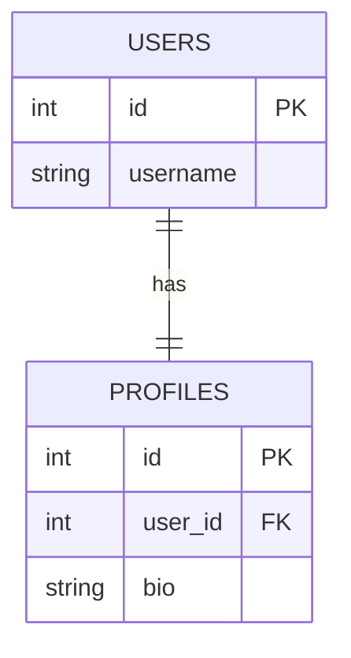
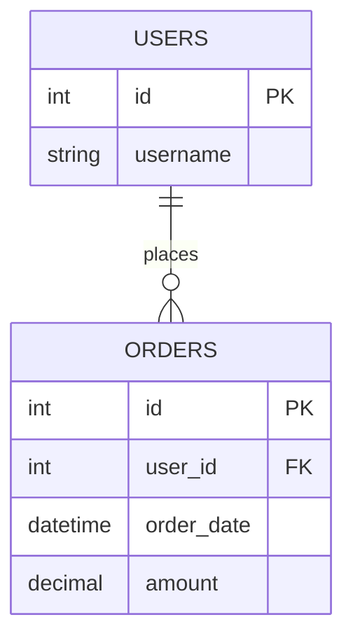
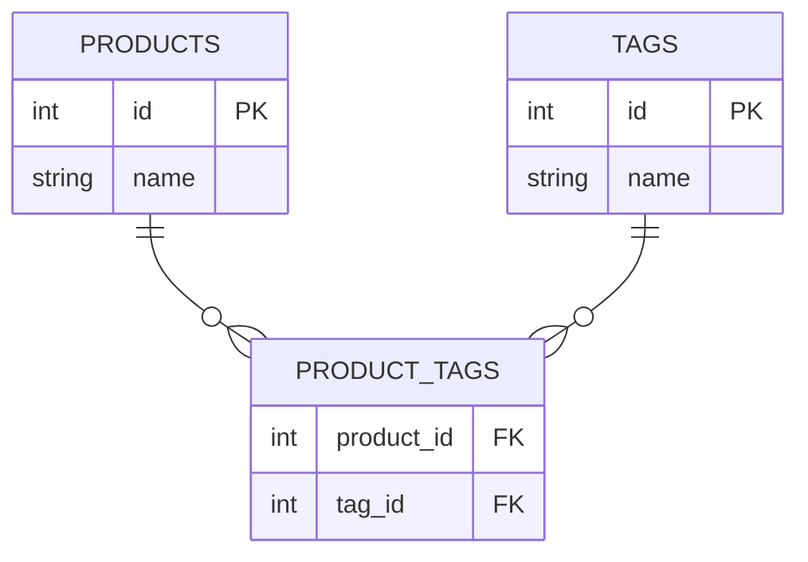

In relational databases, relationships help connect information spread across multiple tables.  
This is essential for modeling real-world scenarios (users have orders, products have categories, etc.).

## Types of Relationships

1. **One-to-One**: Each row in Table A matches one row in Table B.
2. **One-to-Many**: One row in Table A relates to many rows in Table B (most common).
3. **Many-to-Many**: Rows in Table A relate to many rows in Table B, and vice versa (handled via a join table).

## Foreign Keys: The Foundation

A **foreign key** is an attribute (or set of attributes) in one table that refers to the primary key of another table.

- **Purpose:** Enforces data integrity—prevents you from inserting a reference to something that doesn’t exist.
- **Example: Users and Orders (One-to-Many)**
	- One user can have many orders.
	- Each order must belong to an existing user.

| Table          | Column       | Foreign Key Reference | Relationship Purpose                      |
| -------------- | ------------ | --------------------- | ----------------------------------------- |
| `orders`       | `user_id`    | `users(id)`           | Each order refers to a valid user         |
| `product_tags` | `product_id` | `products(id)`        | Links product to tag (many-to-many setup) |
| `product_tags` | `tag_id`     | `tags(id)`            | Links product to tag (many-to-many setup) |
### Why Are Foreign Keys Useful?

- **Prevent orphaned data:** Orders cannot exist for users who do not exist.
- **Maintain integrity:** Automatically blocks invalid references.
- **Cascading Actions:**  
    Example — Delete a user, all their orders are deleted too:

```sql
CREATE TABLE orders (
    id SERIAL PRIMARY KEY,
    user_id INTEGER REFERENCES users(id) ON DELETE CASCADE
);
```

## 1. One-to-One

Each `user` has one `profile`.



```sql
CREATE TABLE users (
    id SERIAL PRIMARY KEY,
    username VARCHAR(64) NOT NULL
);

CREATE TABLE profiles (
    id SERIAL PRIMARY KEY,
    user_id INTEGER UNIQUE REFERENCES users(id),
    bio TEXT
);
```

## 2. One-to-Many

One `user` can have many `orders`:



```sql
CREATE TABLE users (
    id SERIAL PRIMARY KEY,
    username VARCHAR(64) NOT NULL
);

CREATE TABLE orders (
    id SERIAL PRIMARY KEY,
    order_date TIMESTAMP DEFAULT NOW(),
    amount NUMERIC(8,2) NOT NULL,
    user_id INTEGER REFERENCES users(id)
);
```

## 3. Many-to-Many

Products and tags:  
Each product can have multiple tags, each tag can describe multiple products.



```sql
CREATE TABLE products (
    id SERIAL PRIMARY KEY,
    name TEXT
);

CREATE TABLE tags (
    id SERIAL PRIMARY KEY,
    name TEXT
);

CREATE TABLE product_tags (
    product_id INTEGER REFERENCES products(id),
    tag_id INTEGER REFERENCES tags(id),
    PRIMARY KEY (product_id, tag_id)
);
```

- The `product_tags` table forms the bridge, with two foreign keys.

